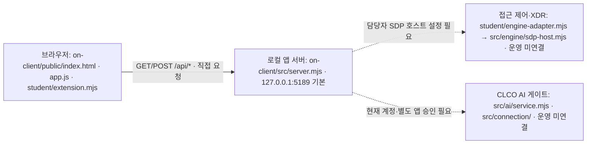

# 켈비 학생 실행 설명서

## Mac 완성본 개발 — 2026-10-26

현재 개발 브랜치는 `finish/kelbi-mac-20261026`, 제공 시작 틀은0.2.19입니다. 이전 main·22단계 제출본·아래 당시 기록은 보존합니다. 공식 ZIP과45개 고정 경로를 대조한 업데이트이며, Windows 전용 업데이트 스크립트 실행이나 설치형 앱 완성을 뜻하지 않습니다.

저장소 루트에서 `ON_PORT=5197 npm start --prefix on-client`를 실행하고 http://127.0.0.1:5197/ 를 엽니다. **보호 현황 → 학생 상태·알림 표시 → 내 Mac · PC 상태 대시보드**의 **PC 상태 다시 조회**를 누릅니다. CPU·메모리·디스크·네트워크 구성은 이 Mac 실측, Windows 방화벽·Windows 기록은 미지원입니다. 상단 **연결 없음**은 보안 엔진 상태이며 PC 실측 성공과 별개입니다.

제공 조회를 바탕으로 학생이 최근20회 비교 기록, CPU·메모리 추이, 확인 불가 이유·수치 근거·다음 행동을 추가했습니다. 버튼을 누를 때만 조회하며 4회부터 그래프가 나옵니다. 기록은 이 탭 메모리에만 있고 새로고침하면 지워집니다. **이 탭의 조회 기록 지우기**는 현재 수치도 초기화합니다. 예제 모드에서 PC 버튼을 눌러도 PC 값은 실제 로컬 조회이며 예제 업무 앱 판정과 섞지 않습니다.

CPU85%·메모리90%·디스크 여유10%는 편의 기준입니다. CPU는200ms 짧은 측정이고, Mac 메모리 값은 캐시·압축·메모리 압력과 다릅니다. 이 값으로 감염·안전·침해 유무를 판정하지 않습니다. 실패 시 현재 카드는 확인 불가, 이전 성공은 과거 기록으로만 표시합니다. 자동 재시도·외부 전송·영구 저장·OS 설정 변경은 없습니다.

로컬73검사(기존62+신규11), 실제 브라우저1280×720에서 PC 실측·4회 그래프·동일 기록표·기록 지우기·새로고침·실제 서버 중단/복구·키보드 초점을 확인했습니다. 실제 새 PC나 다른 사람의 실행, 200% 확대·화면 낭독기·공식 설치 패키지는 미확인입니다. 최종 포장·설치는 담당자가 준비한 Windows 승인 실행 환경을 별도로 필요로 합니다.

## 22단계 완료 당시 기록 — 아래는 2026-10-23 기준

확인일2026-10-23. **검증 중인 학습 버전**이며 전체 운영 제품 v1.0이 아닙니다. 공식 시작 틀은0.2.14입니다. 포털 이름은 켈비이고 제공 앱의 기본 제목·시작 메시지는 케셰브입니다. 이름 저장은 이미 받은 앱 제목을 자동 변경하지 않습니다.

## 목적과 현재 지원 범위

보호 현황·업무 앱·보안 기록 세 메뉴에서 본인 범위의 상태와 기존 엔진 판정·기록을 보여 주고, 사건에 연결된 AI 설명과 조치 상태, 정확한 설치 패키지의 알려진 취약점 조회 결과를 구분합니다. 학생 함수는 판정·탐지·집행 엔진이나 로그인 발급기를 새로 만들지 않습니다.

| 구분 | 직접 확인한 것 | 확인하지 못한 것 |
|---|---|---|
| 환경 | macOS26.1, Node.js24.10.0, npm11.6.0 | 수업 기준 Node24.19.0·Windows PowerShell 실행 |
| 시작·종료 | 새 zsh 터미널의 기본 실행·Ctrl+C·재실행, 실제 브라우저의 연결 없음 | Windows 자격 저장소·네이티브 계정 연결 |
| 학생 화면 | 13~20 로컬62검사, 실제 예제와 기본 앱의 실패·수동 초기화·설정 미완료 | 실제 학생 SDP 로그인·다른 실제 사건 두 개·운영 조치 효과 |
| 공식 판정 | 13~20 모두 필수 코드 기준 통과 | 서버가 앱을 실행하거나 실제 연결을 인증한 결과는 아님 |

Node의 제공 지원 범위는22~24, 수업 기준은24.19.0입니다. 이 프로젝트에서 실제 사용한 것은24.10.0입니다. Node 내장 SQLite의 실험적 경고가 나오지만 그 자체가 앱 기동 실패는 아닙니다. 현재 on-client/package.json의 외부 npm 의존성은0입니다. 앱 실행에 npm install/npm ci를 요구하지 않습니다. 이전 자료실의 루트 package.json/lock과 별개이므로 설치·의존성을 변경하지 않습니다.

## 파일과 역할

```text
프로젝트 최상위
├── README.md                         현재 결과·학생 문서 입구
├── on-client/
│   ├── package.json                  start / demo / check, 시작 틀0.2.14
│   ├── .env.example                  공개 설정 견본, 실제 키 아님
│   ├── public/index.html, app.js      제공 화면·요청·취소·세대 검사
│   ├── public/ai-connect.mjs          제공 계정 연결·앱 승인 표시
│   ├── src/server.mjs                 loopback 앱 서버·입력 검증
│   ├── src/engine/sdp-host.mjs        제공 SDP 연결
│   ├── src/connection/                제공 계정·앱 연결 경계
│   ├── src/ai/                        제공 AI 게이트 통신·검증
│   ├── src/vulnerabilities/           제공 정확 버전 선별·OSV 조회
│   ├── student/extension.mjs          학생 작성 표시 함수8개
│   ├── student/engine-adapter.mjs     제공된 본인 범위 어댑터, 기본 미연결
│   ├── tools/start-alekov.ps1         Windows 공식 실행·연결 준비 도구
│   └── docs/                         변경하지 않은 제공 문서
├── test/stage13-*.mjs … stage20-*.mjs 학생 합성 검사
└── docs/STAGE*_VERIFICATION.md        학생 단계별 근거·한계·실제 판정
```

main에는 기존1~12단계/XDR·과거 기록도 보존합니다. kelbi-product는 동일한 현재 on-client57파일과 학생 검사·문서를 담은 공개 제출 사본입니다. 제공 파일을 학생 성취로 계산하거나 제출에서 런타임을 생략하지 않습니다. 과거 이력 링크는 루트 README에 있습니다.

## 실제 검증한 Mac 실행 절차

1. 기존 저장소 최상위에서 새 터미널을 엽니다. 위치·버전을 확인합니다.

```sh
git rev-parse --show-toplevel
node --version
npm --version
```

2. 아래 명령으로 실행합니다.5194는 이번 독립 검증에 사용한 포트입니다.

```sh
ON_PORT=5194 npm start --prefix on-client
```

3. `케셰브 연결 확인: http://127.0.0.1:5194`가 보이면 브라우저에서 http://127.0.0.1:5194/ 를 엽니다. 세 메뉴와 상단 **연결 없음**이 기본 정상 시작 신호입니다. 서버 실행 문구는 로그인·AI 연결 성공을 뜻하지 않습니다.
4. 종료는 해당 실행 터미널에서 Ctrl+C입니다. 같은 명령으로 다시 실행하고 브라우저를 새로고침합니다. 2026-10-23 15:59에 새 터미널 시작·종료·재실행을 직접 확인했으며 재실행 후에도 연결 없음 상태였습니다. 기존 설정이나 학습 DB를 지우지 않았습니다.
5. 예제를 확인하려면 다른 포트에서 다음을 사용합니다. 이 명령은 앞서 직접 실행해 확인했습니다.

```sh
ON_PORT=5193 npm run demo --prefix on-client
```

http://127.0.0.1:5193/ 는 **예제 데이터(demo)·실제 연결 아님**입니다. 예제의 기기·판정·기록을 운영 성공으로 적지 않습니다. 사용 후 실행 터미널에서 Ctrl+C로 종료합니다.

기본 `npm start --prefix on-client`는 ON_PORT가 없을 때127.0.0.1:5189를 사용합니다(코드 확인). 실제 검증 포트는5192/5194, 예제는5193이었습니다. 호스트는 loopback에만 바인딩됩니다. 포트 사용 중 오류가 나면 그 포트의 본인 실행 창을 확인하며 다른 프로그램을 임의 종료하지 않습니다.

## Windows 공식 경로 — 현재 미실행

Mac 검증을 Windows 검증으로 대체하지 않습니다. 다음은 [제공 실행 안내](../on-client/docs/STUDENT_LAUNCH_GUIDE.md)·실제 tools/start-alekov.ps1에 있는 명령이며 **이번 환경에서는 실행하지 않았습니다**.

파일 탐색기로 현재 저장소의 실제 on-client 폴더를 열고 주소 표시줄에 powershell을 입력합니다. 앱 폴더가 맞는지 package.json·tools/start-alekov.ps1을 확인합니다. 공식 명령은 다음과 같습니다.

```powershell
powershell -NoProfile -ExecutionPolicy Bypass -File .\tools\start-alekov.ps1
```

Node22~24(수업 기준24.19.0), Windows 자격 보관소와 프로젝트별 연결 준비가 필요합니다. 시작 도구의 기동 안내와 표시된 브라우저 주소를 확인합니다. 계정 연결과 AI 앱 승인은 별도이며 같은 ALEPH 계정·확인 번호를 본인이 대조해야 합니다. Mac에서 Windows 보안 검사를 우회하거나 다른 사람 설정을 복사하지 않습니다.

업데이트 도구도 Windows 전용입니다. 이번 Mac에서는 공식 도구의17개 고정 해시와 ZIP 해시를 검증해 지정6파일만 백업·교체했습니다. [업데이트 근거](STAGE17_VERIFICATION.md). Windows 도구를 실행한 것으로 기록하지 않습니다.

## 구성도와 연결 상태



실제 확인된 화살표는 브라우저↔로컬 서버입니다. 서버는 기본 미연결 또는 명시적 demo 엔진을 사용합니다. SDP 어댑터는 호스트가 제공하는 본인 조회·판정만 전달하며, AI는 서버를 통해서만 요청합니다. 공식 준비 도구의 공개 게이트 주소는 https://ai-classroom-gateway-production.up.railway.app 이고 포털은 https://aleph-omega.vercel.app 입니다. 주소의 존재를 코드에서 확인했을 뿐 실제 앱 자격·운영 통신을 확인하지 않았습니다. 설정 견본의 값이 연결 승인을 대신하지 않습니다.

OSV 조회 모듈 src/vulnerabilities/osv.mjs의 고정 공개 endpoint는 https://api.osv.dev/v1/querybatch 입니다. 운영자가 준비한 프로젝트·승인 공개 패키지만 선별합니다. 이 작업에서는 대상 경로·허용 목록을 바꾸거나 외부 OSV 요청을 보내지 않았습니다. 실제 기본 결과는 not_configured입니다.

## 학생 작성 기능과 제공 기능

| 학생 함수 | 현재 구현 | 실제 사용 위치·경계 |
|---|---|---|
| renderIdentity | 사용자·기기·현재 세션·자료별 실패 | 보호 현황 학생 칸, 인증 발급 기능 아님 |
| renderDecision | allow/deny/challenge/unknown·이유·시각 | 업무 앱 학생 칸, 판정은 기존 서버 |
| renderEvents | 받은 기록 정렬·종류/앱/상태 필터·상세 | 보안 기록 학생 칸, 새 XDR 탐지 아님 |
| renderStatus | 기기·세션·알림·진단6필드 수동 복사 | 보호 현황 학생 칸, 직접 diagnostics 호출 없음 |
| renderAiConnection | 점검 전/중/성공/오류·test/verified·한도·취소 | 모델 목록 점검과 사건 설명 구분 |
| renderExplanation | 현재 사건 근거·규칙·unknown·미실행 제안 | 근거 불일치·오류는 성공 속성 제거 |
| renderAction | 준비·사람 확인·ACK·관측 효과·unknown | 표시 전용, 티켓·실행 버튼·POST 없음 |
| renderVulnerabilities | 정확 버전·출처·시각·부분 실패·미조회 | 제공 서버가 검증한 조회 자료만 표시 |

제공 app.js가 API 요청·취소·재조회 세대·안전한 입력과 학생 함수 호출을 관리합니다. 제공 서버가 로그인·권한·응답·사건 결속을 검사합니다. 학생 함수는 DOM 생성과 textContent 표시가 중심이며 자동 집행·재시도·임의 모델을 추가하지 않았습니다. 세션은 현재 검증된 연결 한 개, 기록은 본인 최근40건, 기기는 본인 등록 최대100개의 제공 관측 범위입니다. 실제 이 상한까지 운영 조회한 것으로 주장하지 않습니다.

## 오류별 확인·복구 순서

| 화면/코드 | 이번 확인 범위 | 확인할 것과 다음 행동 |
|---|---|---|
| 연결 없음 / ENGINE_NOT_CONNECTED | 실제 기본 화면 | 서버 주소·앱 폴더 확인 → 담당자 호스트 연결 상태 확인. 가짜 사용자로 대체하지 않음 |
| NATIVE_HOST_DISABLED | 실제 Mac 계정 시작 | 공식 native 경로는Windows 전용. 임의 파일을 만들지 말고 지원 환경·담당자 준비 확인 |
| AI_REQUEST_UNVERIFIED | 실제 기본 점검 | 현재 계정·별도 앱 승인 확인. 성공으로 바꾸지 않음 |
| ON_AI_PROVISIONING_PENDING | 실제 demo 점검·설명 | 담당자에게 앱 권한 준비 확인. 기록·기존 판정은 유지 |
| 인증·접근·한도·이용 시간·모델 없음 | 합성 표시 검사 | 계정/AI 앱 승인·반 사용량·허용 모델을 담당자에게 확인. 키 복사 금지 |
| TIMEOUT / CANCELLED | 합성 표시 검사 | 현재 상태 확인 → 필요할 때 직접 다시 요청. 늦은 응답을 현재 결과로 사용하지 않음 |
| 근거 부족 / ON_AI_INVALID_OUTPUT | 합성 검사 | 같은 사건의 근거·규칙 대조. 없는 ID를 만들어 맞추지 않음 |
| pending / unknown | 합성 조치 검사 | ACK는 효과 아님. 재집행 대신 제공 결과 재조회. 화면 취소는 효과 취소 아님 |
| not_configured | 실제 설치 패키지 조회 | 담당자에게 조회 대상 프로젝트 설정 확인. 학생이 허용 목록 확대하지 않음 |
| partial / unverifiable | 합성 조회 검사 | 이미 받은 ID 유지. 전체 조회를 확인할 수 없다고 안내 |

## 검증·제출·기다림(UNV)

저장소 최상위에서 다음 명령을 실행했습니다. 각 검사 파일은 현재 저장소에 있으며 총62개가 통과했습니다. 단위 검사는 합성 입력이고 실제 계정·모델·집행·OSV 연결 성공을 뜻하지 않습니다.

```sh
node --test test/stage13-identity.test.mjs test/stage14-decision.test.mjs test/stage15-events.test.mjs test/stage16-status.test.mjs test/stage17-ai.test.mjs test/stage18-explanation.test.mjs test/stage19-action.test.mjs test/stage20-vulnerabilities.test.mjs
npm run check --prefix on-client
git diff --check
```

공개 kelbi-product의 전체 현재 앱 커밋을 포털에 저장소 URL·40자리 SHA로 직접 제출합니다. 로컬 원문 JSON은 선택 사항이며 사용하지 않았습니다. 각 실제 판정 대상은 루트 README에 기록합니다. 코드 판정 통과와 실행 확인을 혼동하지 않습니다.

기다림(UNV): Windows native 계정 확인·AI 앱 승인, 실제 학생 SDP 사건과 AI 계정 대응, 실제 모델 생성 설명·취소 경쟁, 실제 원천 조치·효과 조회, 운영 승인 패키지의 원격 OSV 조회와 설치 메타데이터 대조입니다. 새 환경의 같은 최종 소스 재현은22단계에서 별도 확인합니다. 이 항목을 코드 통과만으로 완료 처리하거나 v1.0으로 표시하지 않습니다.

## 비밀·기존 자료 보존

실제 키·토큰·비밀번호·개인키·계정 설정 원문은 문서·화면·Git·로그·제출에 넣지 않습니다. 새 자격 입력·승인은 본인이 공식 입력란에서 수행하며 비밀값을 채팅으로 받지 않습니다. 현재 앱은 .env.example의 실제 비밀을 요구하지 않으며 native 자격은 프로젝트 밖 공식 보관소의 영역입니다. 문서에 공개된 endpoint는 자격이 아닙니다.

원래 main·과거 통과 커밋·학습 DB를 보존합니다. 공식0.2.14 업데이트의 원본 백업과 고정 해시 기록을 별도로 보관했습니다. 옛 공개 Git·배포 이력의 노출을 최신 파일 정리로 해소했다고 주장하지 않습니다. 설명서를 보완할 때 제공 문서를 덮어쓰거나 기능·인증 설정을 바꾸지 않습니다.
